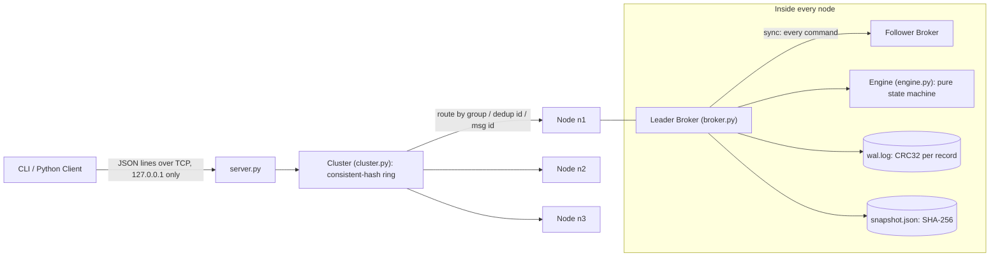

Built with AI assistance (Kiro). I designed the rules, reviewed the code, and ran the tests.

# durable-queue

An SQS-style message queue built from first principles in pure Python (standard library only, zero installs).

It exists to show distributed-systems fundamentals in code you can read in an afternoon: **at-least-once delivery with visibility timeouts, receipt handles, retries with backoff and jitter, dead-letter queues, FIFO message groups, a checksummed write-ahead log with crash recovery, consistent-hash partitioning, synchronous replication with failover**, and tests that *prove* each guarantee instead of asserting it.

> **Scope, honestly:** this is a teaching and portfolio project. Nodes are objects inside one process, not separate machines. It does not run on AWS and is not a drop-in for SQS. See [Limitations](#limitations).

## 60-second quickstart

Requires Python 3.11+. No packages to install.

```powershell
# 1. Run the tests (96 tests, ~35 s)
C:\Users\<you>\AppData\Local\Programs\Python\Python313\python.exe -m unittest
python -m unittest                       # same thing if python is on your PATH

# 2. Watch the guarantees happen (deterministic, ~1 s)
C:\Users\<you>\AppData\Local\Programs\Python\Python313\python.exe -m dq demo
python -m dq demo

# 3. Run a server and talk to it (two terminals)
python -m dq serve --nodes 3 --replicas 1            # terminal 1: 127.0.0.1:7878
python -m dq create orders --max-receive 3           # terminal 2 (auto-creates orders-dlq)
python -m dq send orders "hello"
python -m dq receive orders --max 5
python -m dq stats orders
python -m dq dlq orders-dlq                          # inspect dead letters (add --redrive to replay)

# 4. Measure it on your machine
python -m dq bench            # ~30 s; add --quick for a rough 5 s run, --json out.json for raw data
```

Use it as a library:

```python
from dq import Cluster

cluster = Cluster("data", nodes=["n1", "n2", "n3"], replicas=1)   # durable, partitioned, replicated
cluster.create_queue("dlq")
cluster.create_queue("orders", visibility_timeout=30, max_receive=3, dlq="dlq")

cluster.send("orders", "order-1001")
for msg in cluster.receive("orders", max_messages=10):
    process(msg["body"])                      # must be idempotent (see Guarantees)
    cluster.ack("orders", msg["handle"])      # delete; a stale handle raises InvalidReceipt
```

## Architecture



```
client --TCP--> server --> Cluster --hash ring--> Node(n_k)
                                                   |
                    leader Broker --(same commands, in order)--> follower Broker
                       |  1. stamp time, run command on Engine (in memory)
                       |  2. if state changed: append to wal.log (fsync per policy)
                       |  3. ship to follower, then reply to the caller
                       '-- every N records: snapshot.json + truncate wal.log
```

The key idea: **the Engine is a deterministic state machine.** Every command carries its own timestamp, message id and random jitter, so replaying the same commands always rebuilds the same state. That single property gives crash recovery (replay the log), replication (ship the commands) and model-based testing (compare to a naive reference).

## Guarantees

| Property | Holds? | How it is enforced / tested |
|---|---|---|
| A message acknowledged to the *sender* is not lost on process crash | Yes (any fsync policy) | Log record flushed to the OS before the send returns. `test_durability`, seeded chaos with broker crashes |
| ... on power loss / OS crash | Only with `fsync=always`. `batch` can lose the last batch (up to 64 records or 50 ms), `none` can lose anything unsynced | `test_fsync_policy_*`; cost shown in benchmarks |
| **Delivery: at-least-once** | Yes | Visibility timeout redelivers anything not acked. Threaded stress + 25-seed chaos tests assert no loss |
| **Delivery: exactly-once** | **No**, and no network system can offer it | Duplicates are *demonstrated* (thousands in the chaos run). Idempotent consumer pattern in the demo and `test_idempotent_consumer_*` |
| A stale consumer cannot delete a message redelivered to someone else | Yes | Per-delivery receipt handles. `test_stale_receipt_handle_*` |
| Each message is acknowledged successfully at most once | Yes | Ack removes the message; second ack raises `InvalidReceipt`. Asserted under threads and chaos |
| Poison messages stop retrying | Yes | `max_receive` then dead-letter queue; inspect and redrive. `test_poison_*`, chaos asserts all poison ends in the DLQ |
| Order | Per FIFO **group** only. Standard queues are unordered (redelivery reorders) | `test_fifo_*`, FIFO order preserved across rebalancing |
| Dedup | Within `dedup_window` (default 300 s), per node | `test_dedup_*` |
| Acked write survives leader failure | Yes (1 follower, synchronous replication) | `test_failover_*`, threaded failover under load |
| Torn or corrupt log tail | Recovered: the log is cut at the first bad record | Test truncates the log at **every byte offset** and corrupts records |
| Consistency under network partition | Not applicable: nodes are in-process; no partition handling | See DESIGN.md (CAP) |

## Measured results

All numbers below were measured on this machine; none are estimated. Raw data: `docs/benchmark_run1.json` to `docs/benchmark_run3.json`.

**Machine:** AMD Ryzen 5 PRO 8540U (6 cores / 12 threads), 31 GB RAM, Windows 11 (10.0.26200), CPython 3.13.5. CPU and RAM were read from the OS; `python -m dq bench` prints processor, CPU count, OS and Python version itself.

**Method:** 100-byte messages, one run = send N then receive+ack N (N=20,000; 1,000 for `fsync=always`; 3,000 over TCP). Each table is the **median of 3 full runs** with the min-max range in brackets, because run-to-run noise on this shared laptop was large (up to ~2x). Latency is per call (p50 / p95 / p99, milliseconds). "recv+ack" is one receive of one message plus its ack.

**Thread scaling** (in-process, `fsync=batch`):

| threads | send msg/s | send p50 / p95 / p99 ms | recv+ack msg/s | recv+ack p50 / p95 / p99 ms |
|---|---|---|---|---|
| 1 | 19,496 (19,271-20,888) | 0.023 / 0.056 / 1.158 | 10,764 (8,018-11,796) | 0.039 / 0.114 / 1.299 |
| 4 | 13,317 (12,730-17,816) | 0.047 / 0.548 / 7.151 | 6,882 (6,794-9,950) | 0.091 / 1.271 / 14.338 |
| 16 | 11,513 (11,164-18,881) | 0.049 / 1.444 / 36.454 | 6,530 (5,703-10,114) | 0.096 / 1.450 / 75.654 |

Throughput does **not** rise with threads. That is expected: Python's global interpreter lock lets one thread run Python code at a time, and the broker serialises commands under one lock anyway. Extra threads add queueing, which shows up as p99 latency. Real scaling comes from partitioning across nodes or processes (see DESIGN.md).

**Cost of each fsync policy** (in-process, 1 thread):

| policy | send msg/s | send p50 / p95 / p99 ms | recv+ack msg/s | recv+ack p50 / p95 / p99 ms |
|---|---|---|---|---|
| memory (no log) | 176,378 (147,121-296,440) | 0.005 / 0.007 / 0.012 | 110,046 (83,894-177,587) | 0.008 / 0.012 / 0.015 |
| `none` | 28,783 (26,782-46,710) | 0.030 / 0.048 / 0.090 | 15,629 (15,327-27,278) | 0.056 / 0.094 / 0.143 |
| `batch` | 17,325 (16,930-22,718) | 0.031 / 0.073 / 1.227 | 6,534 (5,524-12,077) | 0.086 / 0.236 / 1.625 |
| `always` | 662 (569-792) | 1.390 / 1.954 / 4.229 | 324 (235-365) | 2.883 / 3.715 / 6.798 |

Reading it: writing and checksumming the log costs roughly 6x (`none`) to 10x (`batch`) on sends versus memory-only. Per-message fsync (`always`) costs a further ~26x on sends against `batch`. That is the durability-versus-throughput trade-off in numbers.

**Over TCP on loopback** (`fsync=batch`, one request per message, no pipelining):

| connections | send msg/s | send p50 / p95 / p99 ms | recv+ack msg/s | recv+ack p50 / p95 / p99 ms |
|---|---|---|---|---|
| 1 | 2,779 (2,512-2,967) | 0.298 / 0.479 / 1.641 | 1,396 (1,251-1,511) | 0.648 / 1.020 / 2.174 |
| 4 | 2,830 (2,339-3,358) | 1.061 / 2.336 / 3.078 | 1,768 (1,525-1,949) | 2.109 / 3.580 / 4.148 |

**Partitioning** (consistent-hash ring, 128 virtual nodes, 50,000 keys; printed by `python -m unittest tests.test_ring -v`):

| change | keys moved | ideal |
|---|---|---|
| 2 -> 3 nodes | 32.90% | 33.33% |
| 4 -> 5 nodes | 18.88% | 20.00% |
| 8 -> 9 nodes | 10.18% | 11.11% |
| 4 -> 3 nodes (remove) | 23.45% | 25.00% |
| Cluster test: add a 5th node with 4,000 real messages | 839 moved = 20.97% | 20.00% |

Evenness (8 nodes, std dev of per-node key count as a fraction of the mean): 1 vnode **1.207**, 16 vnodes **0.225**, 128 vnodes **0.129**, 512 vnodes **0.036**. More virtual nodes give a flatter distribution; 128 is the default, a trade-off against ring size and rebuild time.

**Chaos run** (`python -m unittest tests.test_concurrency -v`, 25 seeds): 3,518 redeliveries, 756 simulated broker crashes with recovery from disk, 200 poison messages (8 per seed) all dead-lettered, **0 messages lost, 0 double acknowledgements**.

## Project layout

See [CODE_MAP.md](CODE_MAP.md) for one line per file and [DESIGN.md](DESIGN.md) for decisions and trade-offs.

## Limitations

- **Single process.** "Nodes" are in-process objects. There is no network between nodes, so network partitions, message loss and clock skew between machines are not simulated. Replication and failover are real code paths, but their failure model is "a node object stops answering".
- **Failover is manual-trigger, no election.** The follower is promoted when a call finds the leader dead. There is no failure detector, no fencing and no split-brain protection. One follower per leader is tested.
- **Replication is synchronous and single-follower**, so a slow follower slows every write; a follower that errors is dropped from the leader (recorded in `replication_errors`).
- **Not scalable across threads.** One lock per broker and Python's GIL: see the thread-scaling table.
- **`batch` fsync has no background flusher.** An idle tail stays unsynced until the next write or close.
- **Log corruption policy:** a bad record in the *middle* of the log discards everything after it, including valid records. A corrupt snapshot refuses to start rather than guessing.
- **Rebalancing** copies messages to the new owner before deleting from the old one, so a crash mid-move can duplicate messages (safe under at-least-once) but never lose them. In-flight messages that move become visible again. Dedup tables do not move with a FIFO group.
- **`max_depth` backpressure applies per node**, not across the cluster.
- **No long polling, no message attributes, no authentication or TLS.** The server only binds to loopback and refuses other addresses.
- **Time uses the wall clock** because timestamps are persisted. A clock that jumps backward can delay redelivery.
- **Verified here:** Python 3.13.5 on Windows 11. The CI workflow targets Python 3.11, 3.12 and 3.13 on Ubuntu but has **not been run** from this machine (no GitHub access); nothing in the code uses features newer than 3.11, but treat 3.11/3.12 as unverified until the first CI run.

## License

MIT, see [LICENSE](LICENSE). All data in tests, demo and benchmarks is synthetic.
